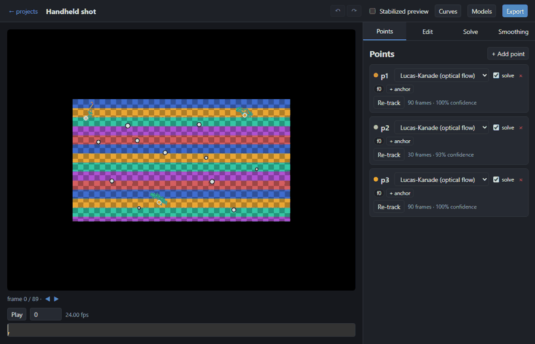

# Stable — open-source point tracking & 2D stabilization

[](https://github.com/stable-tracker/stable/actions/workflows/ci.yml)
[](LICENSE)

A free alternative to Resolve's point tracker / Studio's IntelliTrack. Track
user-defined points with swappable SOTA deep-learning trackers, solve
X/Y/Rotation/Scale motion, edit the tracks, smooth the curves, and export
tracking data or a stabilized video. 2D similarity only — no planar, no 3D.



> **Status: feature-complete through Phase 6.** Decode, proxies, four
> trackers (`lk`, `template`, `cotracker3`, `tapir`) with multi-anchor
> merging, a weighted Umeyama solve with RANSAC, six smoothing filters, a
> stabilized render with crop / auto-zoom / transparent borders and audio
> passthrough, a web UI with on-frame track editing and a full undo/redo
> curve editor, a model-checkpoint download manager, one-command
> `stable serve`, pip packaging, a CUDA Dockerfile, and CI. See `PLAN.md` for
> the full roadmap and phase-by-phase acceptance criteria.

## Quickstart

```bash
pip install "stable-tracker[server,video]"
stable serve
```

`stable serve` builds the frontend if it isn't already built (only relevant
running from a source checkout — a real `pip install` ships it pre-built),
starts the local server, and opens your browser. From there: upload a clip,
place a few points, track, solve, smooth, and export — or try it without your
own footage first:

```bash
stable sample          # writes ./stable-sample/{clip.mp4, tracks.json, curves.csv, stabilized.mp4}
```

`stable sample` runs the bundled ~5s synthetic clip through the real
`track` → `solve` → `stabilize` pipeline with the classic (`lk`) tracker —
no GPU, no model download, nothing to configure — so there is something
concrete to look at within seconds of installing.

`stable serve` listens on this machine only. To open it from another computer
on your network, run `stable serve --host 0.0.0.0` (or set
`STABLE_HOST=0.0.0.0` to make that the default) — Stable has no login, so do
that only on a network you trust.

A track starts from its tracker. **New track** (or `N` / `B`) opens a card:
choose the tracker, and the card shows what that tracker can be started from
and its settings — a point with a pattern size and search area for most, a box
for the ones built to follow objects — while the viewer previews the pattern
and search boxes under the cursor. Then mark the video the way the tracker
wants: a click for a point, a dragged rectangle for a box. The card remembers
your last tracker and its settings for the next track.

Everything a track does hangs off its **anchors**. An anchor says "on this
frame, this feature is *here*"; you can place one on any frame, track forwards
or backwards from it with the `◀` / `▶` beside it on the track's card, and
delete it again — which takes whatever was tracked from it with it. There is no
second concept: an anchor is the only kind of mark a track carries.

In the viewer: `←`/`→` step a frame, space plays, `↑`/`↓` jump between the
selected track's anchors, `A` anchors it where it is on this frame (`⇧A` to
click the position instead), `I`/`O` set the working range, `+`/`-`/`0` and the
wheel zoom, middle-drag pans. Correcting a track needs no mode: select it and
click or drag on the frame (`Ctrl+Z` undoes).
Each point's **pattern** and **search** sizes are per point, chosen on the new
track's card before it is placed and adjustable afterwards on the sliders
beside its patch thumbnails; both are drawn on the frame as a solid and a dashed
box, so a feature bigger than the tracker's default window is a slider away
rather than a reason the track fails.

## Install

```bash
pip install -e .                        # core contracts, NumPy only
pip install -e ".[dev]"                  # + pytest / ruff / mypy
pip install -e ".[video]"                # + PyAV & OpenCV      (classic trackers)
pip install -e ".[server]"               # + FastAPI & uvicorn  (the web UI)
pip install -e ".[video,server]"         # + both -- what `stable serve` needs
pip install -e ".[torch]"                # + PyTorch (CPU by default; see below for CUDA)
```

(Drop `-e .` for the last argument once installing a released version, e.g.
`pip install "stable-tracker[server,video]"`.)

**GPU:** `install.bat` / `install.sh` set this up for you — they run
`scripts/install_gpu.py`, which reads your driver's CUDA version, installs the
matching PyTorch build from PyTorch's own index, and *verifies* the GPU is
actually visible afterwards (falling back to an older CUDA build if not). A
machine with no NVIDIA card is told so and left alone. Run it any time:

```bash
python scripts/install_gpu.py            # asks first
python scripts/install_gpu.py --dry-run  # show what it would do
stable devices                           # confirm: "selected: cuda"
```

Installing the `[torch]` extra by hand gives you a **CPU-only** build on
Windows, which is why the script exists — see
**[docs/windows-gpu-setup.md](docs/windows-gpu-setup.md)** for the manual
route and troubleshooting. On headless Linux, see the CUDA `Dockerfile` at the
repo root instead.

`raft` works as soon as PyTorch is in place (its model ships inside
torchvision), and so do `ocean` and `siamdw`, the two Siamese trackers from
[TracKit](https://github.com/researchmm/TracKit): their network code is MIT and
ships with Stable, and their checkpoints download on first use. They are the
ones to reach for when the feature gets covered — measured on footage with an
occluder sweeping across the point, `siamdw` came back to it every time and
`lk` never did — while `lk` stays the more precise on clean, unoccluded motion.

Both were built to follow an *object* from the box a detector draws around it,
so they can also track **boxes**: choose one for a new track (it arms the box
tool, `B`) and drag a rectangle around something, and the track follows the
box's centre — which is
what the solver, smoothing and export see, as for any track — and its changing
size. Resize an anchor's box by its corners; draw a new box on a later frame
(the ◆ tool) where the object has turned or deformed, and the runs merge like
any other anchors. Exports gain `w`/`h` columns. Ocean regresses each side, so
its box follows changes of shape: on composited clips of a face, a logo and a
blob texture zooming, shrinking and stretching to nearly three times their
aspect, its box overlapped the truth by a mean IoU of 0.92, and recovered after
an occluder crossed it on 11 of 12 clips. SiamDW searches scales, not shapes,
so its box keeps the aspect it was drawn with (mean IoU 0.68 on the same clips,
lost on all three that stretched) — use it for objects that only move and
scale.
CoTracker3 and TAPIR also need their model *code*, which is not ours to vendor
— `stable trackers` prints the exact command for whichever is missing:

```bash
pip install "tapnet @ git+https://github.com/google-deepmind/tapnet.git"          # tapir
pip install "cotracker @ git+https://github.com/facebookresearch/co-tracker.git"  # cotracker3
```

## Model checkpoints — download manager and fail-closed weights

Deep trackers need checkpoints too large to ship in the package, so they
download on first use to `<data root>/models` (see "Where your data is
stored" below; override with `STABLE_MODEL_DIR`). Two things are deliberate,
not bugs:

- **Both shipped checkpoints are unpinned** (no verified sha256 yet) — a
  digest nobody has checked against the publisher would be a lie, so a
  download **fails closed** rather than trusting the network silently.
  Unblock it per-download (a checkbox in the model manager, or
  `--allow-unpinned` on the CLI) or globally with
  `STABLE_ALLOW_UNPINNED_WEIGHTS=1`. See CONTRIBUTING.md "Pinning a
  checkpoint" if you want to verify and pin one for good.
- **CoTracker3's weights are CC-BY-NC (non-commercial)** and are never
  bundled or downloaded silently either — opt in with the model manager's
  checkbox, `--accept-noncommercial`, or `STABLE_ACCEPT_NONCOMMERCIAL=1`.
  TAPIR/BootsTAP's weights are Apache-2.0 and need no licence opt-in, just
  the unpinned one above.
- **Ocean's and SiamDW's checkpoints** (`ocean_offline`, 104 MB;
  `siamdw_res22w`, 10 MB) are pinned and MIT, so they download with no opt-in
  at all. Both come from the authors' SOTS model folder, which TracKit's own
  README now points to; SiamDW's is tensor-for-tensor the one the MIT-licensed
  SiamDW release links, while the SOTS repository hosting Ocean's has no licence
  file of its own — CONTRIBUTING.md "Pinning a checkpoint" has the details.

In the browser, click **Models** (top-right in a project, or from the
project list) to see every checkpoint's cache/licence state and download or
delete it, with live progress. Headlessly:

```bash
stable models                                              # list, with cache/pin/licence state
stable models download bootstapir                          # Apache-2.0, no opt-in needed
stable models download cotracker3_offline --accept-noncommercial
stable models download siamdw_res22w                        # MIT, pinned: no opt-in
stable models remove bootstapir                             # free the disk space back
```

## CLI walkthrough

```bash
stable trackers   # list installed tracker plugins
stable devices    # show what Stable will run on (cuda -> cpu)
stable filters    # list the smoothing filters and their parameters
stable models     # list model checkpoints and their cache state

# 1. track some points
stable track clip.mp4 --point 120.5,80@0 --point 640,360@0 \
    --tracker lk --out tracks.json

# ...sized to the feature: --window is the pattern's half-size in pixels and
# --search how far it may move between frames, both stated in pixels whatever
# the plugin calls its own arguments (a tracker that has no search area says so
# rather than ignoring the flag)
stable track clip.mp4 --point 120.5,80@0 --tracker template \
    --window 24 --search 48 --out tracks.json

# ...or follow an object from a box, given as left,top,width,height@frame the
# way a detector reports it (Ocean and SiamDW; the output adds each frame's size)
stable track clip.mp4 --box 300,200,120,90@0 --tracker ocean --out tracks.json

# 2. export the solved X/Y/R/S curves
stable solve tracks.json --out curves.csv --video clip.mp4

# 3. or go straight to a stabilized video (audio passed through)
stable stabilize clip.mp4 --tracks tracks.json --out stable.mp4 \
    --smooth butterworth:cutoff_hz=1.0 --border auto_zoom

stable stabilize clip.mp4 --tracks tracks.json --out locked.mp4 --tripod
stable stabilize clip.mp4 --tracks tracks.json --out frames/ --border transparent

# 4. or the whole pipeline as one command, against the bundled sample clip
stable sample ./my-sample --tracker lk --border auto_zoom

# 5. the web UI, built (if needed), served, and opened for you
stable serve
```

## Where your data is stored

Projects are big — a single clip's proxies and renders run to gigabytes — so
Stable keeps them **next to the installation**, not in your home directory:

```
<the directory you installed Stable into>/.stable/
    projects/     one directory per project: source clip, proxies, tracks, renders
    models/       downloaded tracker checkpoints
```

`stable serve` prints the exact location on startup. Installing onto a big
data drive is therefore all it takes to keep the data there too, which is the
point: a home directory on a small system SSD fills up fast.

The resolution order is `$STABLE_HOME`, then the source checkout Stable is
installed from, then the active virtualenv, then `~/.stable` as a last resort
(a system-wide `pip install`, where writing next to the package would mean
writing into `site-packages`). To put the data somewhere else entirely:

```bash
STABLE_HOME=/mnt/media/stable stable serve      # both stores
STABLE_WORKSPACE_DIR=/mnt/media/projects        # just the projects
STABLE_MODEL_DIR=/mnt/media/checkpoints         # just the checkpoints
```

**Upgrading from an older version?** Everything used to live under
`~/.stable`. The first launch after upgrading moves it into the new root and
says so as it goes. It is a per-project move, so an interrupted run resumes
next time; it refuses rather than filling the destination drive; and a project
name already present in the new location is never overwritten. Nothing is
deleted from the old location until its copy has landed.

## Docker (CUDA)

For a headless Linux GPU box (on Windows, run natively — see the GPU setup
doc above, which is also simpler since it lets `stable serve` reach your
browser):

```bash
docker build -t stable-tracker:cuda .
docker run --rm -it --gpus all -p 8000:8000 \
    -v stable-workspace:/root/.stable/projects \
    -v stable-models:/root/.stable/models \
    stable-tracker:cuda
```

Then open <http://localhost:8000>. See the `Dockerfile` for what it installs
(CUDA 12.4 base, Python 3.11, PyTorch's matching CUDA wheel, both deep
trackers' model code) — the frontend is already built into the package
(`stable/server/webdist`), so the image never needs Node.js.

## What exists today

| Module | Contents |
|---|---|
| `stable.core.types` | `Query`, `TrackResult`, `PointTrack` — the universal tracking contract |
| `stable.core.geometry` | `SimilarityTransform` — the 4-DoF motion model (X, Y, R, S) |
| `stable.core.corrections` | The typed, non-destructive manual-edit layer |
| `stable.core.project` | Project file schema v1: load / save / migrate |
| `stable.core.device` | `select_device()` — CUDA when available, CPU always works |
| `stable.trackers.base` | `TrackerPlugin` — the swappability core |
| `stable.trackers.registry` | Entry-point discovery of third-party trackers |
| `stable.trackers.merge` | Multi-anchor merging: confidence blend, anchor falloff, disagreement |
| `stable.trackers.dummy` | A deterministic tracker so everything is testable |
| `stable.trackers.lk` | Pyramidal Lucas-Kanade with forward-backward confidence |
| `stable.trackers.template` | NCC template matching with adaptive template update |
| `stable.trackers.deep` | The model lifecycle (device, weights, GPU→CPU fallback); chunked inference and its backend seam |
| `stable.trackers.siamese` | Siamese trackers as point trackers: a fixed anchor template, the point riding on the network's own reading |
| `stable.trackers.siamese_nets` | The Ocean and SiamDW networks, ported from TracKit to plain PyTorch |
| `stable.trackers.ocean` | Ocean (TracKit): anchor-free box regression — accurate on object-like features |
| `stable.trackers.siamdw` | SiamDW (TracKit): CIResNet-22W SiamFC — tracks through occlusion and says so |
| `stable.trackers.chunking` | Window planning and overlap stitching for long clips |
| `stable.trackers.confidence` | One confidence scale every plugin normalises onto |
| `stable.trackers.weights` | Lazy, checksummed, licence-gated model download |
| `stable.trackers.cotracker3` | CoTracker3 (Meta) — CC-BY-NC weights, opt-in |
| `stable.trackers.tapir` | TAPIR / BootsTAP (DeepMind) — Apache-2.0 weights |
| `stable.video.source` | `PyAVVideoSource` — real, random-access video decode |
| `stable.video.proxy` | Half/quarter-res JPEG proxy generation + disk-backed serving |
| `stable.video.encode` | FFmpeg export via PyAV, with audio passthrough |
| `stable.solver.similarity` | Confidence-weighted Umeyama fit, with lockable degrees of freedom |
| `stable.solver.ransac` | Outlier rejection from minimal samples, deterministic |
| `stable.solver.motion` | Per-clip solve: X/Y/R/S curves, residuals, graceful degradation |
| `stable.smoothing.dsp` | Butterworth / filtfilt / Savitzky-Golay / spline, in pure NumPy |
| `stable.smoothing.filters` | The six-filter catalogue, its schema and the strength blend |
| `stable.smoothing.channels` | Per-channel enable & strength, round-tripped through the project file |
| `stable.smoothing.motion` | Smoothing a solve into a stabilization warp |
| `stable.smoothing.edit` | Curve-editor operations: sub-range blend, pin |
| `stable.render.warp` | The per-frame affine and the three border policies |
| `stable.render.stabilize` | Planning a render, streaming it to a file or PNG sequence |
| `stable.server.tracker_options` | Per-point pattern/search sizes: which arguments a plugin lets the operator set, in what units |
| `stable.server.clip_range` | The In/Out markers, bounding both tracking and export |
| `stable.core.derive` | A track built from other tracks: their per-frame midpoint, on the clip's own clock |
| `stable.server.render_queue` | Renders that wait to be asked for: the stored queue, its order and its estimates |
| `stable.trackers.frames` | The bounded per-run cache of colour-converted frames |
| `stable.trackers.features` | SIFT / ORB feature matching — survives an occlusion instead of drifting through it |
| `stable.trackers.sam3` | SAM 3 (Meta): segments the object and rides the point on it |
| `stable.server.app` | The FastAPI app: routing, static frontend, packaged-vs-source dist resolution |
| `stable.server.jobs` | The background job queue + WebSocket progress, incl. model downloads |
| `stable.server.routes.models` | Model checkpoint list / download / delete, the UI's model manager backend |
| `stable.server.history` | Undo/redo over the corrections layer |
| `stable.examples` | The bundled ~5s sample clip (`stable sample`, CI's integration test) |
| `stable.cli.track` | The `stable track` subcommand |
| `stable.cli.solve` | The `stable solve` subcommand — curve export as CSV/JSON |
| `stable.cli.stabilize` | The `stable stabilize` subcommand — the whole pipeline |
| `stable.cli.models` | The `stable models` subcommand — list / download / remove checkpoints |
| `stable.cli.serve` | The `stable serve` subcommand — build, serve, open the browser |
| `stable.cli.sample` | The `stable sample` subcommand — the bundled clip end to end |

## Design invariants

* **One result type.** Every tracker returns a `TrackResult`; nothing downstream
  knows which model produced it. That is what makes swapping in the next SOTA
  tracker a packaging problem, not a code change.
* **Absolute frame indices.** Track arrays span the whole clip (`T =
  video.frame_count`); untracked frames are `NaN`. No range offsets anywhere.
* **Raw output is immutable.** Track arrays are read-only. Manual edits are a
  typed correction layer applied on top, so undo is "drop a correction" and
  re-tracking never destroys the user's work.
* **Multi-anchor by default.** A point holds several anchors; runs go
  bidirectionally from each and are merged tracker-agnostically. The merged
  track passes through every anchor exactly, and disagreement between
  overlapping runs lowers confidence — that dip is the UI's "fix this" signal.
* **One confidence scale.** Every plugin normalises its scores to *P(this
  position is accurate to within a few pixels)*, so the solver can weight a
  transformer and an optical-flow tracker with the same arithmetic.
* **Degrade, don't die.** No GPU, a GPU that won't load the model, or a window
  that blows out VRAM mid-job all fall back to the CPU and finish. The solver
  does the same with data: three points get RANSAC, one point gets X/Y only,
  none gets interpolated — and every frame records which happened, so the UI
  can flag the ones worth looking at instead of silently guessing.
* **Smoothing is the stabilization.** The warp is `smoothed(t) ∘ raw(t)⁻¹`, so a
  channel that is not smoothed is not stabilized — exactly, not approximately.
  "Off" and "strength 0" are bit-for-bit bypasses.
* **NumPy only.** The filter designs, `filtfilt`, Savitzky-Golay and the
  smoothing spline are implemented here rather than pulled from SciPy, so the
  stabilizer never fails to run because a scientific stack is missing.
* **Weights fail closed, not silently.** An unpinned checksum or a
  non-commercial licence blocks a download until an explicit opt-in — never a
  workaround, always a visible choice (in the model manager UI, the CLI, or
  an environment variable).

## Adding a tracker

Publish a package advertising the `stable.trackers` entry-point group:

```toml
[project.entry-points."stable.trackers"]
my_tracker = "my_package.tracker:MyTracker"
```

Subclass `stable.trackers.TrackerPlugin`, implement `track()`, done — it shows
up in `stable trackers` and in the UI's picker. For a deep tracker, subclass
`DeepTrackerPlugin` instead and you inherit chunked inference, resolution
scaling, CPU fallback and checksummed weight download; you supply the model and
what its scores mean. **See [CONTRIBUTING.md](CONTRIBUTING.md) for the full
guide**, including confidence calibration and weight licensing.

## Tests

```bash
python -m pytest                    # everything, including the headless integration check
python -m pytest -m "not integration"   # unit + component tests only (fast)
python -m pytest -m integration         # the bundled-clip CLI pipeline check, on its own
python -m ruff check . && python -m mypy
cd web && npm run build             # tsc --noEmit + vite build
```

CI (`.github/workflows/ci.yml`) runs all of the above — lint, unit tests, the
headless integration check, the frontend build — plus a packaging job that
builds a real wheel and installs it into a clean virtualenv on both Ubuntu
and Windows runners to prove `pip install` → `stable serve` actually works
with nothing else on disk.

## License

MIT for this code. Model weights carry their own licenses — CoTracker is
CC-BY-NC (non-commercial), TAPIR is Apache-2.0. Non-commercial weights are
opt-in downloads and are never bundled.
